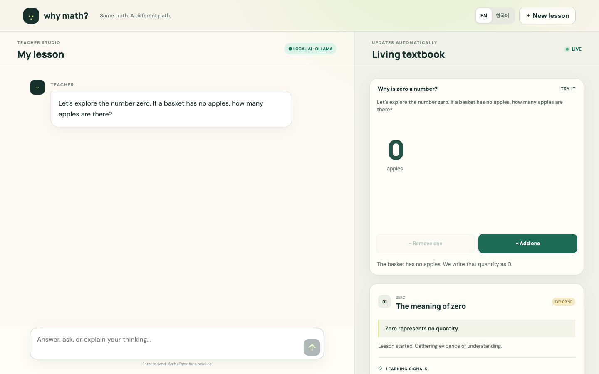

# Why Math?

**The lesson adapts to you.**

An infinitely patient AI tutor that designs a unique learning experience for every student. Instead of asking students to adapt to a fixed lesson, Why Math? adapts explanations, visualizations, interactions, pace, and progression to their actual understanding.

Built for the **c0mpiled-17 Seoul hackathon — The Primer**, November 9, 2026.

## Contents

- [What we're building](#what-were-building) — the product experience
- [Hackathon demo](#hackathon-demo) — the smallest proof
- [Project documentation](#project-documentation) — product brief, scope, and development workflow
- [Development status](#development-status) — what is and isn't implemented

## Hackathon demo (under 90 seconds)

[Watch or download the English-narrated fast-cut demonstration](demo/why-math-90s-demo.mp4) · [Submission description](demo/SUBMISSION.md) · [Narration and timing](demo/NARRATION.md). The 27-cut video explains why the project exists (fixed lessons, formula memorization without understanding), compares two same-age simulated learners, includes actual Korean/English app captures, 3D PNG math illustrations, and expressive English narration; it is not a claim of proven learning outcomes.

## Presentation package (without the real browser footage)

The [presentation kit](demo/presentation-kit/README.md) includes the approved 72-second English narration (WAV and M4A), original PNG opening and ending cards, transparent lower-third captions, pitch copy, presenter notes, English SRT/WebVTT captions and the precise edit timeline. **Fourteen actual browser-recording segments are intentionally missing.** The final assembler refuses to render substitute footage. [Download the complete kit ZIP](demo/why-math-presentation-kit.zip).

## Product preview

The teacher leads a lesson; a learner can answer, ask, or explore. Its Living Textbook updates automatically. The first interactive visual is an illustrated counting exercise assembled from PNG layers.



Mobile interface: [View screenshot](docs/screenshots/why-math-mobile.png).

---

## What we're building

1. **AI-led lessons.** Students do not need to know what to ask. The tutor begins with a logical math learning sequence.
2. **Adaptive instruction.** The tutor responds to student understanding and vocabulary, changing examples, explanations, visuals, questions, and pace.
3. **Generative learning design.** A validated concept structure guides dynamically generated learning experiences rather than requiring a complete prewritten textbook.
4. **Living textbook.** A personalized learning record is assembled automatically from each student's lesson, without a manual save action.
5. **Bilingual learning.** Korean and English lesson flows are targeted for the demo.

**Core principle:** Same mathematical truth. A different path to understanding for every student.

## Hackathon demo

Three simulated 14-year-old students can follow the same lesson with different understanding profiles, behind an explicit Test Mode switch. The same AI teacher adapts its next lesson, and each student's living textbook updates automatically. The demo should support real live runs and a clearly labeled replay of recorded events.

Target deliverables: working app, GitHub repository, 90-second English presentation/demo video. The video may show both Korean and English AI lessons.

## Project documentation

- [Product brief](docs/PRODUCT_BRIEF.md)
- [Hackathon scope and acceptance checks](docs/HACKATHON_SCOPE.md)
- [Development workflow and adaptive UI specification](docs/DEVELOPMENT_WORKFLOW.md)
- [gStack stage gates and quality evidence](docs/GSTACK_STAGE_GATES.md)
- [Latest build and QA checkpoint](docs/checkpoints/2026-11-09_MVP_P0_QA.md)
- [Visual asset policy](docs/VISUAL_ASSET_POLICY.md)
- [Image attribution and sources](docs/ASSET_SOURCES.md)

## Development status

**Working hackathon MVP (November 9, 2026).** React/Vite UI and Express API, guided and free entry, Ollama-powered Korean/English lessons (including mid-session language switching), three test-only AI learners, automatic Living Textbook updates, and local session persistence are implemented. The teacher uses a small reviewed concept map (zero, number line, negative numbers), not a complete curriculum. Mathematical accuracy, user learning outcomes, general-topic routing, cloud security and production scale are **not validated**. The Codex CLI path may time out and is experimental; the offline fallback is explicitly labeled. A first interactive PNG/transparent-sprite counting scene and an English-narrated 90-second demo video are delivered. Additional lesson visuals, GIFs, formal account systems and general math curriculum coverage remain future work.

### Run on MSM2-1

```bash
cd /Volumes/MSM2-1-DATA/Projects/95_Why-Math
npm install
npm run check
npm run dev
```

Browse `http://localhost:5173`. The API runs at `http://localhost:8787`. The default live teacher uses a local Ollama service with `gemma3:4b`; install and run the model separately when using a fresh host. The UI can use a labeled offline fallback if the model is unavailable. By default the API binds to `127.0.0.1` only, and no public deployment is configured.

For the judge demo, select **AI student testing mode (simulation)** and one of the three fixtures; real learners do not see that fixture selector by default. Demo replay and offline scripted actions are never evidence of real students' learning gains.

**Security:** This is a local hackathon app, not a production multi-user learning platform. Sessions require unguessable access capabilities, but there is no full account, abuse protection, privacy policy or managed hosting. Do not publicly expose the backend or input real minors' personal data. Existing sessions from before access-token protection cannot be reopened from the browser.

## License

License not yet selected. Do not assume reuse permission for third-party content or source code.
