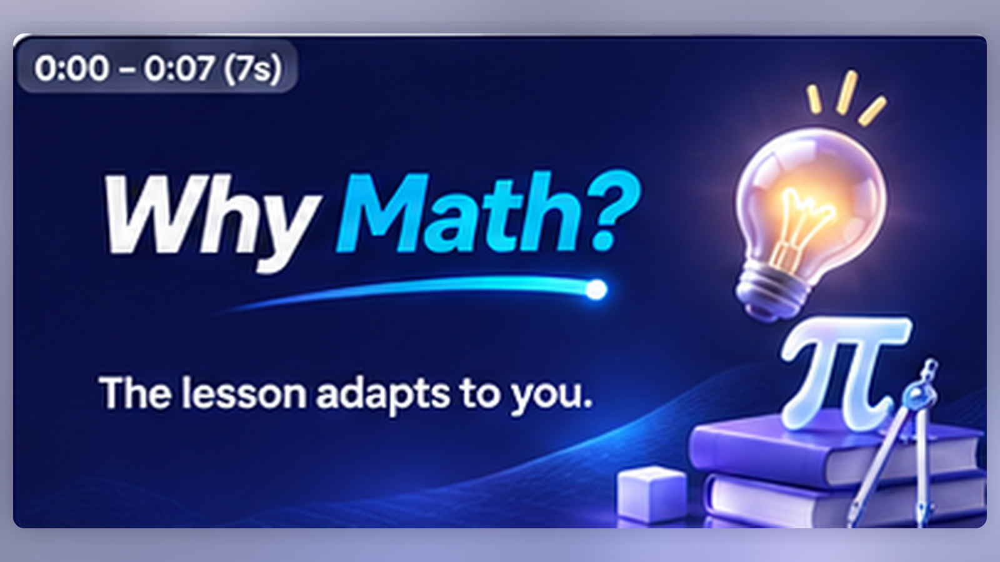
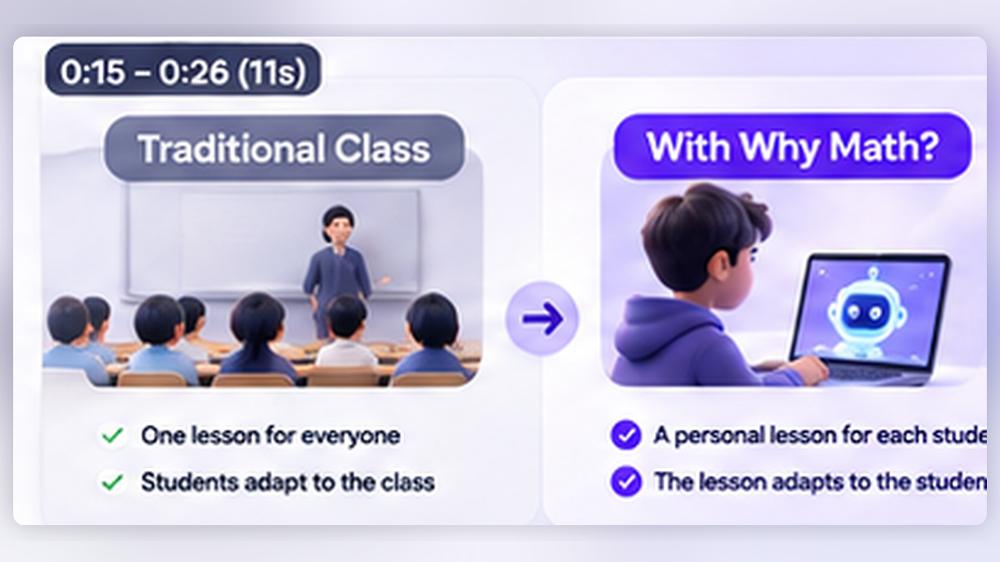
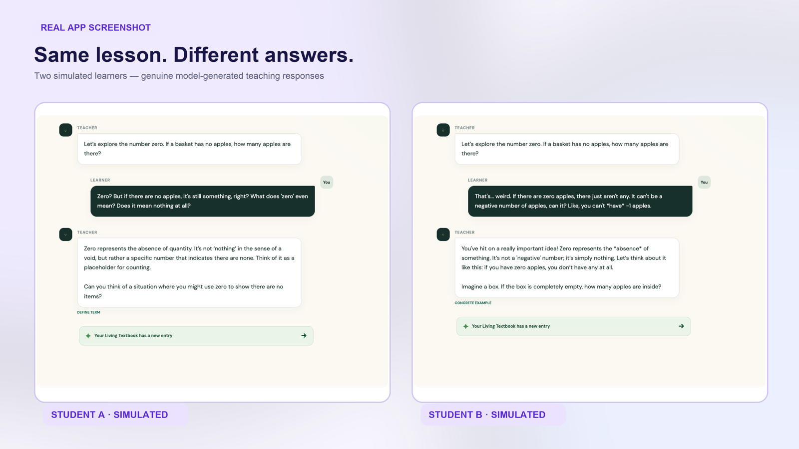
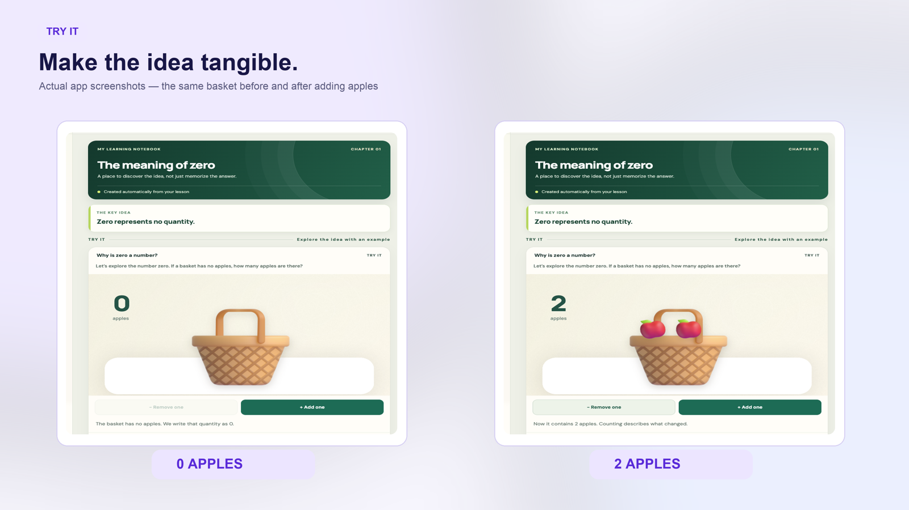
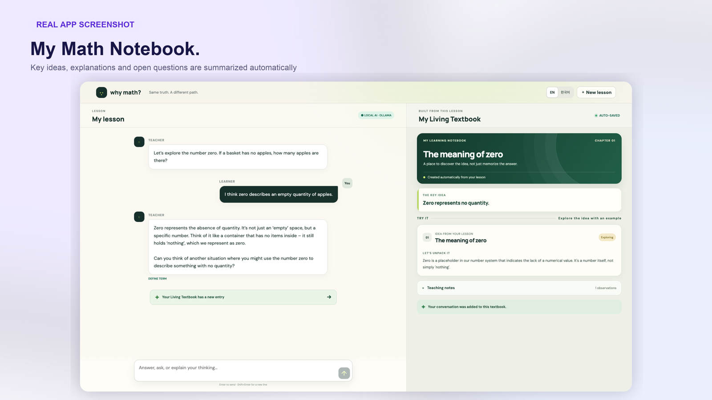

# Why Math?

**The lesson adapts to you.**

An AI-led math tutor that starts teaching, listens to each learner, and changes the next explanation based on what they actually understand. Instead of forcing everyone through the same lesson, Why Math? offers a different path to the same mathematical truth.

[**Try the public beta**](https://whymath.krako.xyz) · [Watch the 96-second demo](demo/why-math-final-demo-96s.mp4) · [Send feedback](https://github.com/hkalbertkim/why-math/issues)



<small>Built at c0mpiled-17 Seoul, The Primer track · November 2026. The public beta is experimental.</small>

<br />

## Contents

- [Try it](#try-it) — start a real AI-guided lesson in English or Korean
- [Why this exists](#why-this-exists) — one mathematical truth, different learning paths
- [The working prototype](#the-working-prototype) — teacher-led sessions, interactive examples, math notes
- [Run locally](#run-locally) — development commands and model setup
- [Limits and privacy](#limits-and-privacy) — what has and has not been proven
- [Docs and feedback](#docs-and-feedback) — technical notes and ways to contribute

<br />

## Try it

**Public beta:** https://whymath.krako.xyz

Choose **Guided curriculum** or **Free exploration**, then start with zero, a number line, or negative numbers. The AI teacher asks a question, listens to your reply, and selects the next explanation. A personal math notebook grows automatically during the lesson.

The public test is planned to remain available for at least one month starting November 9, 2026. It is hosted on an always-on development computer, **not** a commercial uptime-guaranteed cloud service. Daily message limits protect capacity. Do not enter names, school information, contact details, or other personal data.

<br />

## Why this exists

Students often memorize formulas without understanding what they mean. A learner who does not know the vocabulary may not even know how to ask a useful question. Why Math? starts with the teacher, not an empty chat box.



The essential teaching loop is **start → observe → explain → verify → update**. Age can change presentation. Evidence of understanding should change the lesson.

<br />

## The working prototype

### One teacher, different paths

Two simulated 14-year-old test learners can start with the same objective and receive different model-generated explanations based on their replies. These agents are **testing fixtures**, not two separate teaching engines and not evidence of real-world educational effectiveness.



### Learn by doing

The first interactive lesson uses a raster PNG apple-and-basket activity. Add and remove apples to explore zero, then explain the concept in your own words to the teacher.



### Your own math notebook

The notebook collects the key idea, generated explanation and observations from the current lesson. Questions and uncertainty remain visible; one answer does not certify mastery. The interface is available in English and Korean.



<br />

## Run locally

Requires Node.js, npm, and [Ollama](https://ollama.com/) for the live local model.

```bash
ollama pull gemma3:4b
npm ci
npm run check
npm run dev
```

Open http://localhost:5173. The API runs on localhost:8787. The local app includes a labeled offline fallback when a model is unavailable. The hosted beta uses a separate isolated data file and dedicated server process.

<br />

## Limits and privacy

- **Early proof of concept:** current curriculum is limited to zero, number lines and negative integers. The system has not been validated across arbitrary mathematics.
- **No proven learning gains:** the three AI student personas are simulations used for software QA, not human learning studies.
- **Small reviewed fact set:** targeted arithmetic checks exist, but model-generated explanations can still be wrong. Educator review and deterministic verification remain necessary.
- **No accounts:** a browser keeps an unguessable session capability locally. Clearing browser storage loses the ability to resume that session.
- **Public beta guardrails:** fair-use limits apply to session creation and AI calls; saved sessions are scheduled for deletion after approximately 30 days. The service is not approved for real minors' personal information.
- **Availability:** a one-month trial is planned, but this is an experimental service without an uptime SLA.

<br />

## Docs and feedback

[Product brief](docs/PRODUCT_BRIEF.md) · [Development workflow](docs/DEVELOPMENT_WORKFLOW.md) · [Quality gates](docs/GSTACK_STAGE_GATES.md) · [Final UI QA](docs/checkpoints/2026-11-09_FINAL_UI_QC.md) · [Visual asset sources](docs/ASSET_SOURCES.md)

Issues, bugs and suggestions: [GitHub Issues](https://github.com/hkalbertkim/why-math/issues).

The slide illustrations above are deterministic PNG derivatives of the **existing 12-slide hackathon presentation**, not newly generated SVGs. The math app screen captures shown in the presentation are actual product UI.

**License:** Not yet selected. Do not assume the source code or third-party illustrations are available for unrestricted reuse.
